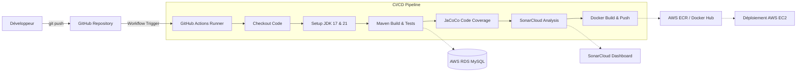

# TP3 DevSecOps : Pipeline CI/CD - Analyse & Déploiement d'une application Spring Boot

Ce projet contient l'implémentation complète des **deux TPs** de DevSecOps et Microservices :
1. **DevSecOps TP03** : Création de l'application Spring Boot de gestion des employés, intégration Maven, base de données MySQL et dépôt GitHub.
2. **Ing.Sys.sec TP03 (Suite)** : Pipeline CI/CD avec GitHub Actions, analyse de qualité/sécurité du code avec **SonarCloud / SonarQube**, couverture de code avec **JaCoCo**, conteneurisation **Docker**, et liaison avec une base de données **AWS RDS MySQL**.

---

## 🏗️ Architecture du Pipeline CI/CD



---

## 📁 Structure du Projet

```text
employe/
├── .github/
│   └── workflows/
│       └── deploy.yml              # Workflow GitHub Actions CI/CD complet
├── src/
│   ├── main/
│   │   ├── java/ma/ensias/employe/
│   │   │   ├── EmployeApplication.java       # Point d'entrée Spring Boot
│   │   │   ├── configuration/
│   │   │   │   └── EmployeConfig.java        # Configuration Beans (ModelMapper, Service)
│   │   │   ├── controller/
│   │   │   │   └── EmployeController.java    # Contrôleur REST (/employes/{id})
│   │   │   ├── entite/
│   │   │   │   └── Employe.java              # Entité JPA Employe
│   │   │   ├── reponse/
│   │   │   │   └── EmployeReponse.java       # DTO Réponse Employé
│   │   │   ├── repository/
│   │   │   │   └── EmployeRepo.java          # Spring Data JPA Repository
│   │   │   └── service/
│   │   │       └── EmployeService.java       # Logique métier avec ModelMapper
│   │   └── resources/
│   │       ├── application.properties        # Configuration générale
│   │       └── application-prod.properties   # Configuration profil production (AWS RDS)
│   └── test/
│       ├── java/ma/ensias/employe/           # Tests unitaires & intégration (96% couverture JaCoCo)
│       └── resources/
│           └── application.properties        # Configuration pour environnement de test (H2)
├── Dockerfile                      # Image Docker multi-stage optimisée & sécurisée
├── docker-compose.yml              # Stack locale prête à l'emploi (App + MySQL)
├── init.sql                        # Script SQL d'initialisation de la base employedb
├── pom.xml                         # Dépendances Maven (Spring Boot, ModelMapper, JaCoCo, Sonar)
└── RAPPORT_TP3.md                  # Rapport détaillé des étapes et interprétation SonarQube
```

---

## 🚀 Guide d'Exécution Rapide

### 1. Tester localement avec Maven Wrapper
```bash
./mvnw clean test
```
*Génère le rapport de couverture JaCoCo consultable dans `target/site/jacoco/index.html` (96% de couverture).*

### 2. Démarrer avec Docker Compose (App + Base MySQL)
```bash
docker-compose up --build
```
L'application sera accessible sur : `http://localhost:9090/employes/10`

### 3. Pousser sur votre GitHub
Si votre repo GitHub `employe` est créé :
```bash
git push -u origin main
git push -u origin feature/dev
```

---

## 🔐 Secrets GitHub à Configurer (`Settings > Secrets and variables > Actions`)

| Secret | Description | Exemple |
|---|---|---|
| `SONAR_TOKEN` | Token d'accès généré sur SonarCloud | `fbfabd211b963a499b6...` |
| `DB_URL` | URL JDBC de l'instance AWS RDS | `jdbc:mysql://<endpoint-rds>:3306/employedb` |
| `DB_USERNAME` | Nom d'utilisateur master RDS | `admin` |
| `DB_PASSWORD` | Mot de passe master RDS | `votreMotDePasse` |
